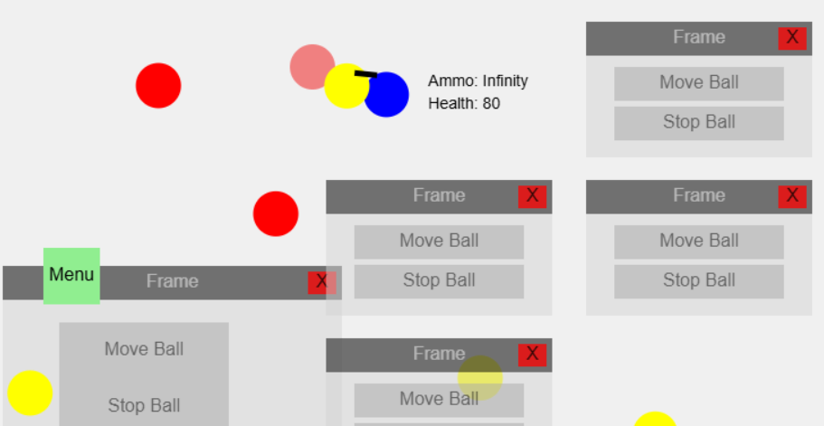
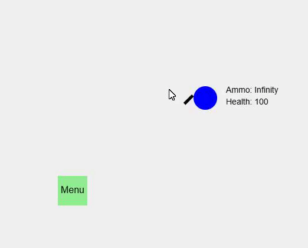
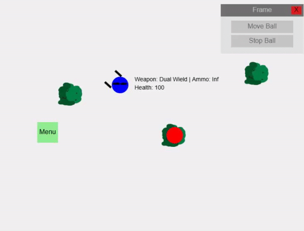

# vgungame
This project will be about a basic shooter game, this is going to rely on a mouse and keyboard to shoot. As of now, this game is not as polished, and is more focused on the physics and how it works first, so not much of "design," but more on functionality, maybe even like a sandbox game.

# Code Info
So this game is displayed on the web, which is through a canvas and html. The main part of this project is the actual game, which is through javascript.

# Game
This is a link to the web game
https://jimuv.github.io/vgungame/

# How to play
Note: This is only for PC, on the web
### Website and Canvas
On the website, if you scroll down, you should be able to see another "How to play"

On the game canvas, there is a tutorial, once you press "Start game", "Tutorial", and then select a map (Map2 recommended).

For gamemodes, there is sandbox, and 5 wave. "5 wave" is where the gameplay is at, and "sandbox" is to test everything out without much enemies

### Keybinds
The basics of this game is that you press 'f' to shoot, 'g' to melee, and shortcuts are 'm' for menu, and 'n' for shop

For player movement, use WASD to move in 4 directions.

### Game ui
With the game's ui, there are frames, which you can drag them, or exit them out.

On the menu, there are 7 buttons, 

The significant button on the menu is the "Shop" button, which allows you to equip things

Other buttons on the menu includes the Settings and Skins, which as of now are basic.

Move ball, Stop Ball, and Add moving ball are part of the sandbox, and debugging.

#### Shop
On the shop, it is important to drag it into frame, which then you can see more buttons.

There you would see 4 purple buttons, and 2 "Prev" and "Next" buttons which are for pages

The 4 purple buttons are "Guns", "Utility", "Skins", and "Armor"

You could purchase in each category, and go through multiple pages if there is any (As of now, only guns have pages)

In the gun section, there are different unique guns you can try out

# description
As of enemies, this will probably be just a target practice, zombies, or actual enemies might be later. My vision for this game is basically to have progression and customizability, though this may remain a skeleton, or like a demo, which I will reuse this for more polished games using the same system/physics.

Note: I am planning to make this a sandbox mode for the early stages, and will work on playability, such as waves in the future

<!-- This game is intended for PC though I am trying to make it so mobile can play it too, which as of now its partially playable. -->

# problems
Some problems I'm facing right now is actual game design, I would say that I have no idea what im planning to make, which im basically just adding stuff as I learn.

# showcase

