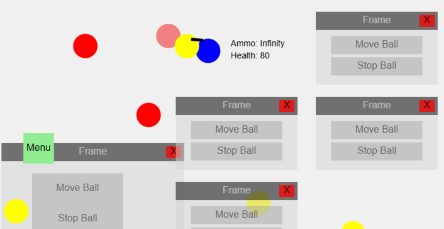
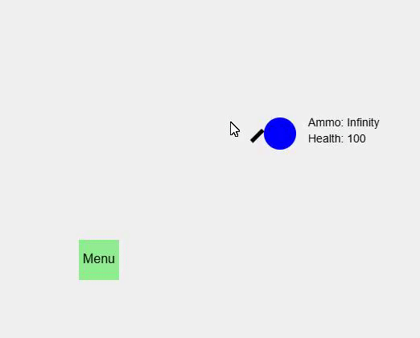
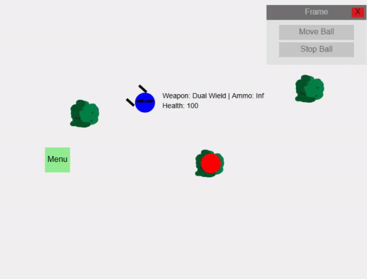
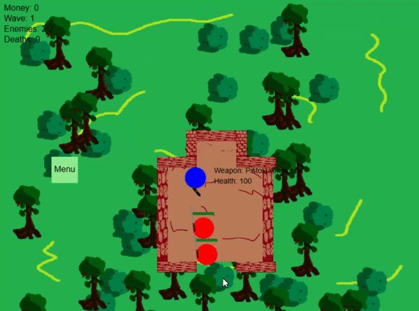
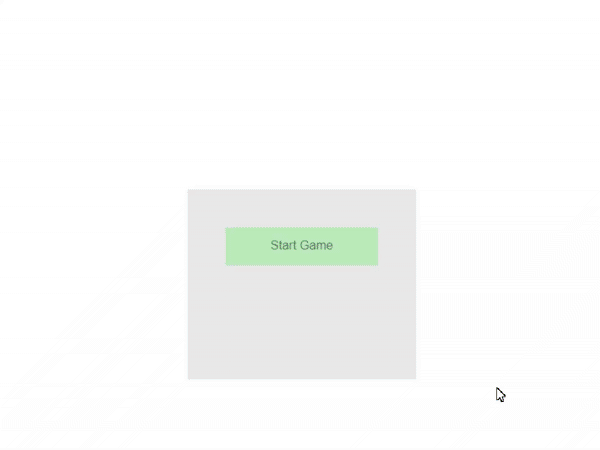

# vgungame
This project will be about a basic shooter game, this is going to rely on a mouse and keyboard to shoot. As of now, this game is not as polished, and is more focused on the physics and how it works first, so not much of "design," but more on functionality, maybe even like a sandbox game.

# Code Info
So this game is displayed on the web, which is through a canvas and html. The main part of this project is the actual game, which is through javascript.

# Game
This is a link to the web game
https://jimuv.github.io/vgungame/

# How to play
Note: This is only for PC, on the web
### Website and Canvas
On the website, if you scroll down, you should be able to see another "How to play"

On the game canvas, there is a tutorial, once you press "Start game", "Tutorial", and then select a map (Map2 recommended).

For gamemodes, there is sandbox, 5 wave, Normal mode, and Hard mode. Note: "5 wave" came from Week 1 and the rest is from other weeks, and "sandbox" is to test everything out without much enemies

Note: after completing 5 Wave mode or other gamemodes, you will need to restart in order to play again, do this by pressing 'esc' or 'p' then pressing exit (Endless as an exception).

### Keybinds
The basics of this game is that you press 'f' to shoot, 'g' to melee, and shortcuts are 'm' for menu, 'n' for shop, 'h' for toggling enemy healthbars, and 'esc' or 'p' to pause/resume the game

For abilities, you hold 't', and press either '1' '2' '3' '4' or '5' to choose which to use, as of now there are grenade and speed

For player movement, use WASD to move in 4 directions, "Ctrl" to dash forward, and "Shift" to sprint.

You could rebind keys on the keybinds menu, which you can get to by going to settings then clicking keybinds (refer to Game ui section)

### Game ui
With the game's ui, there are frames, which you can drag them, or exit them out.

On the menu, there are 7 buttons, 

The significant button on the menu is the "Shop" button, which allows you to equip things

Other buttons on the menu includes the Settings and Skins, which as of now are basic.

On settings, you can change the background (only if its black/white), toggle or adjust sound, and toggle walls (for testing)

There is also a button on settings called "keybinds" which opens a keybinds menu, that you can change different keybinds.

Move ball, Stop Ball, and Add moving ball are part of the sandbox, and debugging.

#### Shop
On the shop, it is important to drag it into frame, which then you can see more buttons.

There you would see 4 purple buttons, and 2 "Prev" and "Next" buttons which are for pages

The 4 purple buttons are "Guns", "Utility", "Skins", and "Armor"

You could purchase in each category, and go through multiple pages if there is any (As of now, only guns have pages)

In the gun section, there are different unique guns you can try out

In the skins section, there is many items that costs money, you can obtain these by killing enemies (the red balls), which you can now equip the item once buying it and owning it. Utilities are not one time purchase, which you can buy multiple times, costing you money each time.

#### Enemies
So there are a variety of enemies, they have the same weapons that are provided in the shop, the boss as of now is the "Demon Slayer" ball. They each have a healthbar, which you can toggle off and on with 'h' (Refer to Keybinds). The following feature uses BFS pathfinding, so enemies wont be stuck against a wall. Once an enemy dies, they have a chance of dropping ammo (+10 as of now), and gaurunteed +10 money. A special enemy I added (week 2) was the medic enemy, which heals its surroundings.

# description
As of enemies, this will probably be just a target practice, zombies, or actual enemies might be later. My vision for this game is basically to have progression and customizability, though this may remain a skeleton, or like a demo, which I will reuse this for more polished games using the same system/physics.

# notes
As of now, there are mutliple modes, I am currently working on the wave modes. This is a game updated on top of multiple weeks.

If you are trying to review a specific week, on the web page (the demo link), if you scroll down, there should be a list of features added in specific weeks (I may miss some)

<!-- This game is intended for PC though I am trying to make it so mobile can play it too, which as of now its partially playable. -->

# problems
Some problems I'm facing right now is actual game design, I would say that I have no idea what im planning to make, which im basically just adding stuff as I learn.

# showcase

note: these may be outdated gifs

<table>
  <tr>
    <td></td>
    <td></td>
  </tr>
  <tr>
    <td></td>
    <td></td>
  </tr>
</table>